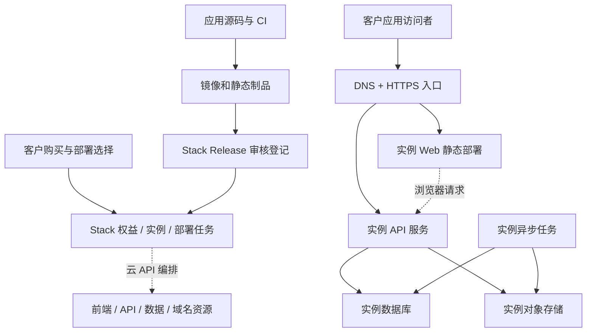

# 历史提案（已停止执行）

2026-10-07 决策：放弃 CloudBase、SAE 及多云产品拼装。现行方案见 [部署业务方案](../app-lifecycle-and-managed-hosting-plan.md)。以下仅供历史查阅，内部相对链接以原 docs 目录为基准。

# Stack 应用业务闭环与独立实例托管方案

日期：2026-10-03。状态：设计提案，尚未实现托管能力或创建云资源。

实施进展：Retail 首个真实应用的 Manifest v1 发布校验、无源码镜像交付和隔离自部署闭环已完成，详见 [接入验收](retail-stack-onboarding-runbook.md)。本文中的托管能力仍是规划，不表示已经部署到国内或国际云。

当前范围更新：应用由 Lingcoo 自行开发维护，Git 源码经 CI 构建为镜像，Stack 负责标准接入、内部上架、销售、权益和镜像部署。保留应用列表和购买入口；开放应用商城、第三方开发者平台及分账暂不实施。后文静态托管、静态包和复杂计量属于候选扩展，本期不作为应用接入必需条件。前后端可通过独立镜像部署；更新采用新版镜像拉取与重新部署，并保留配置和持久数据。具体责任与更新流程以 [接入责任契约](app-platform-responsibility-contract.md) 的当前阶段范围为准。

基于当前代码、既有《Stack 应用接入与镜像交付标准》、桌面独立实例托管方案、`lingcoo-complete-chat-record.md`、`新一代_Web应用部署基础设施_应用中心.md` 和用户提供的国内/国际部署图整理。当前实现以 [platform-architecture.md](platform-architecture.md) 为准；本文定义下一阶段目标，不能作为已上线能力说明。

## 1. 定位与设计决策

应用交付物、Stack 平台能力、接口信任边界及双方验收职责详见 [应用与 Stack 接入责任契约](app-platform-responsibility-contract.md)。

Stack 将应用接入、审核、发布、售卖、权益、交付和托管运维串成闭环。部署后的应用如何使用及其账号、登录、成员和业务权限均与 Stack 无关，不纳入平台接入协议。

- 一个客户购买某个应用后，可以在权益允许的数量内创建实例；每个实例独立配置、授权、版本、数据凭据和访问入口。
- 同一业务实例可以由静态 Web、API、任务处理器、数据库和对象存储等多个资源组成。实例数量与容器副本数量分开计算。
- 支持 `self_hosted`（客户服务器）与 `managed`（Lingcoo 托管）；客户云账户 BYOC 留作扩展。
- 首期托管按 Lingcoo 持有云账户、向客户收取托管费用设计。实际云账户、区域和商品价格在试点前确定。
- 用户选择的是部署方式、区域和服务规格；云产品组合由经过验证的托管模板决定，不把任意供应商组合交给用户拼装。
- 国内与国际部署从第一版协议开始并列设计。腾讯云、阿里云、国际云和客户服务器都是部署目标；首个真实托管模板优先从国内候选中验证，不能预设必须先完成国际方案。
- 客户运行资源不部署到 Stack 自身服务器上。Stack 的 API、数据库、任务调度、审计及监控仍需要资源和容量规划。
- 独立实例默认包含独立数据库与凭据，但不承诺独占物理主机。共享数据库表加 tenant_id 不作为本方案的默认交付方式。

## 2. 当前能力与差距

| 环节       | 当前代码证据                                                                            | 本轮需要补齐                                   |
| ---------- | --------------------------------------------------------------------------------------- | ---------------------------------------------- |
| 应用与售卖 | `apps`、`app_offers`、`plans`、`features`；版本化商品导入规范                           | 接入审核、上架检查和托管规格关联               |
| 标准交付   | `src/lib/delivery-manifest.ts`；installer、domainSlots、envFields、secretFields、assets | 严格版本协议、组件拓扑、资源能力、生命周期约束 |
| 交易与授权 | Checkout、Billing、License 的交易/退款/权益用例                                         | 软件授权与托管服务的独立计费及失效规则         |
| 自有服务器 | deployments、deploy token、配置交换、状态上报、更新操作                                 | 固定 Release、兼容新实例模型，完整端到端再验收 |
| 发布版本   | Manifest 和镜像配置、部署元数据中的更新信息                                             | 独立、不可变、可审核的 Release                 |
| 客户实例   | deployments 已承担部分长期部署对象职责                                                  | 明确 Instance 与每次部署执行的区别             |
| 云托管     | 目前未形成统一托管资源模型                                                              | 云适配器、资源编排、域名证书、成本与故障恢复   |

特别注意：现有 `installs` 表有 `extensionInstallId`、设备指纹等字段，用于客户端安装绑定，不能直接当作托管实例表复用。已有部署逻辑含 WordPress 等特定产品动作，新协议应将它们收敛到产品交付适配层，避免云托管核心继续增长产品分支。

## 3. 业务全流程

### 3.1 应用方：接入到上架

1. 注册 App，确认稳定 appCode、维护方、应用说明、支持的部署模式和支持周期。
2. 提交协议 Manifest、配置定义、组件清单、迁移/初始化/健康检查/备份恢复能力。
3. 源码仓 CI 测试并构建一次，输出镜像 digest、静态包 checksum、代码 revision 与构建来源。
4. Stack 接收发布登记，校验调用方所属应用和制品来源，保存不可变 Release 快照。
5. 在隔离环境验收安装、升级、恢复与授权行为；分别标记自部署和托管模式的兼容性。
6. 运营配置套餐、价格、实例数量、更新权益、托管规格与服务说明；审核通过后上架。

App 上架、Release 发布、实例部署是三个独立动作。发布新 Release 只增加可选择版本；下架 App 停止新销售，不默认停止已购买实例。撤回危险 Release 禁止新安装，已有实例按单独修复策略处理。

### 3.2 客户：购买到获得权益

1. 应用目录 → 详情 → 选择软件套餐；展示支持的交付方式及托管费用范围。
2. 创建订单并锁定价格、货币、套餐权益快照，避免后续改价改变历史订单。
3. 服务端支付验证成功，幂等发放软件权益；跳转成功页不能作为支付依据。
4. “我的应用”展示可创建实例数量、授权期限、可使用版本和可选部署方式。
5. 创建实例时再次检查权益、资源所有权和数量上限，并发创建要预占额度。

软件购买成功不等于已部署，也不等于已购买托管服务。支持先购买、以后部署；赠送/人工授权也必须进入统一权益和实例检查。

### 3.3 自有服务器

选 Release → 创建实例 → 填域名与必要配置 → 获取短期 deploy token → 在客户服务器执行安装 → 交换实例专属配置 → 迁移/初始化 → 健康检查 → 上报实际版本及运行状态。

保留现有交互，协议升级通过兼容适配器接入。正式制品、安装脚本及 Manifest 应固定到已批准版本，不能安装时重新取可变 main 分支。token 限定实例、用途和有效期，支持撤销和安全重试；长期状态上报凭据与一次性交付凭据分开。

客户掌握服务器 root 权限时，可以提取服务器上可用的凭据；“页面不显示密码”不能构成凭据对客户不可见的保证。镜像拉取应使用应用/仓库限定、可撤销或短期凭据，不能下发平台主凭据。交付容器镜像也不等于业务代码不可提取。

### 3.4 Lingcoo 托管

选 Release → 选区域/规格与子域名 → 展示费用和额度 → 开通托管服务 → 创建实例并预占容量 → 异步创建资源 → 迁移/初始化 → 发布 API/Web → 验证 HTTPS 与就绪状态 → 标记运行并交付入口。

推荐首期托管服务计费从实例交付成功开始；开通失败不重复扣软件费，云端残留资源进入清理和对账。供应商已经发生的失败部署费用由平台成本账记录。收费起点、试用和退款规则必须在商品中明确。

用户看到部署步骤、进度、失败原因及重试入口，不需要复制云平台密钥或操作 GitHub Actions。

### 3.5 持续运营与退出

实例详情提供版本、状态、域名、软件权益、托管服务、用量、账单、日志摘要、备份和升级入口。

- 升级：检查兼容性 → 备份 → 锁定实例部署 → 执行兼容迁移 → 发布候选版本 → 健康验证 → 切换流量 → 记录实际版本。
- 回滚：只有数据库仍兼容旧应用时才能直接回滚代码；破坏性迁移采用分阶段变更、修复发布或明确恢复流程，不承诺镜像回退即可恢复数据。
- 续费：软件更新权益、软件运行授权、托管期限分别判断；永久软件授权不应因托管到期消失。
- 欠费/退款：按服务规则通知、宽限、暂停运行，保留导出与数据保留期限；不把退款事件直接映射成删库。
- 删除：用户明确执行销毁后，检查备份与保留期限、撤销域名路由和凭据、清理资源、核对账单，记录审计。保留期和备份删除期限应有实际值，不能无限保留。
- 迁出：支持数据库与文件导出、自部署接管；跨云迁移涉及一致性、短暂停写和验证，作为独立操作，不只是切换 mode 字段。

## 4. 统一接入协议

在既有 `fd-delivery.manifest.json` 上制定新主版本，保留旧版本适配。以下为协议设计项，尚不是当前解析器支持的字段。

| 协议部分   | 必须表达的内容                                                                   |
| ---------- | -------------------------------------------------------------------------------- |
| 身份与版本 | protocolVersion、appCode、releaseVersion、sourceRevision；协议版本与应用版本分离 |
| 制品       | 镜像 digest、静态包 checksum、平台架构、构建来源；禁止正式 Release 依赖 latest   |
| 组件       | web(static/SSR)、api、worker/job；启动命令、端口、依赖关系和必需/可选属性        |
| 持久化     | PostgreSQL 版本/扩展要求，其他数据库、队列、Redis、对象存储和持久卷要求          |
| 配置       | 类型、校验、用户输入/平台预设、公开/secret、构建期/运行期、是否允许修改          |
| 网络       | Web/API 入口、内部端口、健康路径、回调地址、可信代理、CORS/CSRF 来源             |
| 生命周期   | migrate、bootstrap、backup、restore、health、readiness；超时、幂等和执行权限     |
| 兼容性     | 支持的部署模式、最低资源、是否支持缩零、任务类型、升级前置版本和数据库兼容范围   |
| 授权与管理 | 实例身份、授权验证、状态上报、更新指令、撤销与离线宽限策略                       |

协议声明应用需要什么，Provider 适配器决定在云上怎样满足。不能把 Cloud Run 或 ACR 的配置字段变成所有应用必须理解的核心协议。

通过严格 Schema 校验、语义检查和真实交付测试共同验收。旧 normalize 函数不能单独充当新版发布验收器；远程 Manifest 与制品 URL 要限制来源、大小、重定向、超时及内网访问，且获取成功不能自动进入发布态。

静态 Web 只接收公开配置，数据库密码、平台密钥不进入构建产物。优先运行时注入公开 API 地址或使用同源 `/api`；需要构建期配置的框架应显式声明并记录该实例产物。SSR Web 归类为计算服务，不能假设能按静态文件部署。

每个应用先验证其实际数据库和持久化依赖。现有 WordPress 类交付不能因为统一托管方案采用 PostgreSQL，就被假设能直接迁移到 Neon。

## 5. 核心对象与模块边界

| 对象                 | 含义与所有者建议                                                                |
| -------------------- | ------------------------------------------------------------------------------- |
| App / Offer / Plan   | 应用、售卖入口、权益套餐，沿用 App/License 边界                                 |
| Release              | 不可变协议与制品快照、兼容性和审核结果，由发布模块管理                          |
| Entitlement          | 软件使用权、版本权、实例额度，由 License 管理                                   |
| HostingSubscription  | 托管规格、计费周期、额度与服务状态，由托管订阅领域管理并复用 Billing            |
| Instance             | 客户某应用的长期交付对象，关联 owner、app、entitlement、mode、当前/期望 Release |
| DeploymentRun        | 某次部署/升级/恢复操作及步骤、错误和幂等键，由部署编排管理                      |
| ResourceBinding      | 实例组件对应的云资源 ID、区域、账户引用、规格、密钥引用，由基础设施模块管理     |
| DomainBinding        | 实例入口、域名所有权、DNS/TLS/路由状态，由域名模块管理                          |
| Backup / UsageRecord | 恢复点与保留期、原始用量及归属，分别服务运维和计量                              |

这些是领域边界，不要求拆成微服务。继续使用模块化单体，跨模块公开端口、表归属和事务规则沿用当前工程底座。

当前 deployments 已有长期身份和 token 外键。实现前选择增量演进或新实例表映射，保留旧 ID/API 与存量数据；另建 DeploymentRun，不能把原表直接改解释为历史执行记录。托管数据库与 Stack 控制数据库分离，应用运行时只拿自身数据库凭据。

## 6. 部署编排与可靠性

建议部署任务主路径：`queued → provisioning → migrating → deploying → verifying → succeeded`；可转入 `failed / compensating / cancelled`，取消只在安全检查点执行。实例另有运行状态，任务失败不应把仍正常运行的旧版本误标为离线。

1. 在短事务中校验权益、预占实例额度、记录期望版本并持久化任务；云 API 调用放在事务外。
2. 使用现有任务基础设施承载执行，评估补齐租约、重试、超时、心跳、步骤持久化和定期对账；不先自建通用工作流引擎。
3. 供应商请求带稳定资源标识及幂等键。创建超时后先查询结果，再决定重试，避免重复付费资源。
4. 同一实例的升级/恢复/销毁互斥。执行前重新检查授权、任务代次与取消状态。
5. 记录每一步创建或复用的资源；补偿只能删除本次创建且确认可安全删除的资源，不能删客户原有数据库。
6. DNS、TLS、数据库就绪采用异步轮询和退避；对账恢复崩溃后的任务并识别孤儿资源。
7. 长期凭据进入专用密钥存储或受控加密存储，数据库只持引用；日志和任务输出脱敏。每实例最小权限，平台云凭据不进入应用容器。
8. Stack 短暂不可用不应立即中断客户所有业务。应用业务运行不要求在线依赖 Stack；Stack 在部署、更新和托管管理操作时校验权益，运维状态上报采用可重试机制。

## 7. 运行架构与首期模板

CI 构建并登记 Release，Stack 决定哪个实例何时部署哪个版本。浏览器不直连具有管理权限的数据库；文件直传可采用限定对象和有效期的签名 URL。数据库和对象存储是并列依赖，不是请求必然依次经过的链路。

**国际候选模板：静态托管 + Cloud Run API + Neon PostgreSQL + R2/S3。** 前端每实例有独立配置、发布记录和域名，允许复用相同静态制品，不必每个客户建立源码仓。API 默认每实例独立服务，可按流量起多个副本；数据库优先独立项目/数据库与凭据，存储采用独立 bucket 或经验证的强制作用域授权。

这是基于当前需求的选型建议，尚未经过本项目云端试点。区域可用性、API 自动化、账户资源数量、创建速率、恢复能力、商业条款和实际账单是上线前门槛；不能将免费额度作为商业成本模型。

- Cloud Run 服务可按请求扩缩，但常驻轮询 Worker 不能直接套用 HTTP 服务的闲置缩零假设。周期任务、推送队列和持续任务分别选择 Jobs、事件触发或常驻计算。[官方扩缩说明](https://docs.cloud.google.com/run/docs/about-instance-autoscaling)
- Neon 可暂停闲置计算；存储、历史保留和其他计费项仍需预算。优先把 API 与数据库放在邻近区域，实测连接池、冷启动和网络延迟。[Neon 计算管理](https://neon.com/docs/manage/endpoints/)
- Supabase 的每项目专属数据库计算按小时计费，不能与 Neon 的闲置自动缩零成本直接等同；需要其 Auth/Storage/Realtime 等能力时再评估整体收益。[Supabase 计算计费](https://supabase.com/docs/guides/platform/manage-your-usage/compute)
- Cloudflare Containers 可作为后续模板，通过 Worker 控制按需容器；并非把 Cloud Run 的部署参数原样替换即可。需要验证实例隔离、路由、生命周期、持久化和账户限额。[Containers 概览](https://developers.cloudflare.com/containers/)；[资源限制](https://developers.cloudflare.com/containers/platform/limits/)
- Railway、Vercel 等保持候选，不在首期并行实现所有适配器。

**国内模板独立验收：** 可以评估单一国内云的静态托管/对象存储 + 容器托管 + 应用所需数据库，减少跨云网络与运维复杂度。SAE 支持容器交付，但其具体缩零、入口和计费配置应单独验证。[SAE 托管说明](https://www.alibabacloud.com/help/en/sae/application-deployment-overview)

不能把 CloudBase 数据能力与任意 PostgreSQL 应用视为自动兼容，也不能默认国内托管数据库具有 Neon 相同的成本曲线。国内镜像/静态包分发、域名接入和经营要求应在选定供应商、地域及运营主体后核实；国际模板通过不代表国内模板通过。

### 7.1 多目标部署选项

以下组合是需要试点验收的候选，不表示目前已支持。模板同时固定供应商产品、地域、网络和资源规格，不能仅记录一个 provider 名称。

| 目标模板       | Web                                             | API / 任务                              | 数据与文件                                        | 选用条件                                     |
| -------------- | ----------------------------------------------- | --------------------------------------- | ------------------------------------------------- | -------------------------------------------- |
| 腾讯云中国大陆 | EdgeOne Pages 国内可用区，或 CloudBase 静态托管 | CloudBase Run；持续任务单独验证运行策略 | TencentDB PostgreSQL + COS；同地域 VPC 连通性实测 | 大陆用户；满足域名接入要求；应用符合运行限制 |
| 阿里云中国大陆 | OSS 静态托管 + CDN/HTTPS                        | SAE；HTTP 与后台任务分别配置            | RDS PostgreSQL + OSS；同地域 VPC                  | 大陆用户；镜像、网络及数据库依赖兼容         |
| 国际按需托管   | CF Pages / Vercel 等选定一种                    | Cloud Run，后续可接 CF Containers       | Neon / 按需选定数据库 + R2/S3                     | 目标用户区域、运行依赖及网络符合要求         |
| 自有服务器     | 本机静态服务或另选已验收静态模板                | 现有 Docker/deploy token                | 本机或客户提供的兼容数据库/存储                   | 用户管理服务器、域名及资源费用               |

腾讯 CloudBase Run 支持容器应用及 VPC 资源访问，但具体数据库连接、安全组和区域必须实测；CloudBase 内置数据库不是 PostgreSQL 的自动替代。[CloudBase Run 说明](https://docs.cloudbase.net/run/introduction)

SAE 官方说明缩零受应用场景和 CPU 分配模式限制，因此模板应显式记录缩零能力与后台任务策略。[SAE 缩零条件](https://help.aliyun.com/zh/sae/does-sae-2-0-all-applications-support-shrinking-to-0)

腾讯云服务的最小副本、空闲判定与计费也需按具体产品核实，不直接沿用 Cloud Run 参数。[云托管服务说明](https://docs.cloudbase.net/run/faq/server)

模板优先在同一家云、同一地域组合 API、数据库和文件存储，减少跨云连接、出网和故障定位成本。前后端仍可独立发布。客户确有需求时再开放经过验证的跨云组合，不承诺任意组件随意互换。

### 7.2 协议、模板与适配器的分工

- Application Manifest 声明应用能力需求，例如 OCI 容器、PostgreSQL 版本/扩展、对象存储、WebSocket、持续 Worker、最小内存。
- DeploymentProfile 是版本化部署模板，声明 `targetMarket`、provider、region、网络策略、支持的能力、制品来源、域名要求、计费规格和运维策略。可使用 `cn-tencent-v1`、`cn-aliyun-v1`、`global-cloudrun-v1`、`self-hosted-compose-v1` 等稳定标识。
- ProviderAdapter 实现预检查、计划、创建、查询、更新和清理；错误分类、幂等、资源归属和凭据边界使用统一约定，保留供应商特有能力，避免强行抹平差异。
- 创建实例前匹配 Manifest 与模板能力；不兼容就明确说明原因，禁止静默把 PostgreSQL 换成 D1/MySQL，或把常驻 Worker 放进仅处理请求的运行模式。
- 实例保存模板版本、区域及资源绑定。更换云供应商属于数据迁移操作，不是修改下拉框后重新启动。
- COS/OSS/R2/S3 在签名、权限、URL 和 SDK 上存在差异，使用应用存储端口与经测试的实现；只有能力被验证时才能声明兼容。

### 7.3 国内网络的完整交付链路

1. **构建与制品分发：** 源码可以继续由 GitHub 管理；CI 将批准的镜像同步到国内 ACR/TCR，静态包、Manifest 和安装脚本同步到国内可访问的对象存储。部署节点只拉取制品，不在启动时依赖 GitHub raw、npm 安装或海外镜像源。同步须记录校验值和来源，验证完成才把该 Release 标记为国内可部署。
2. **构建执行位置：** GitHub Actions 与国内云的推送链路实测不稳定时，采用受控国内构建执行器或云上构建任务；仍固定 revision、锁文件和依赖来源，避免不同地区构建未经审核的不同版本。
3. **客户运行链路：** 检查 HTML/JS、字体、图片、API、上传下载、登录、支付回调、邮件/短信和第三方服务。将关键海外依赖本地化或提供兼容国内服务；CDN 缓存不能解决所有 API 跨境连接问题。
4. **控制链路：** 测试实例访问 Stack 授权、状态上报、更新、备份接口的能力，以及 Stack 访问供应商 API 的能力。按目标市场选择可达管理入口，离线授权宽限沿用既定策略；如需区域执行器，使用有限权限和持久任务队列，不自行复制一套可写交易/权益数据库。
5. **数据链路：** 数据库、对象存储、备份和日志的实际地域纳入模板；“前端使用国内节点”不能作为数据在国内的证明。默认不跨境复制客户数据，迁移时单独核对目的地域和用户约定。
6. **实测门槛：** 从大陆电信、联通、移动网络检查 DNS/TLS、首次打开、登录、API、文件传输及冷启动；在供应商控制 API 暂时不可用时验证恢复。记录测试地区、时间、失败率和延迟，不用单一海外探针作为国内可用证明。

### 7.4 域名与客户选择流程

用户流程调整为：选择应用 → 购买权益 → 选择自部署/托管 → 选择主要服务地区 → 查看兼容的部署方案、价格和域名条件 → 创建实例。

面向大陆用户优先展示腾讯云和阿里云国内模板；国际模板作为明确选项，不能把香港/海外节点描述为与大陆部署等价。企业客户可以选择指定云；普通用户采用平台推荐且已验收的模板。未实现或未通过验收的选项不能销售为可立即开通。

EdgeOne Pages 官方区分中国大陆与全球（不含大陆）可用区，对大陆加速的自定义域名有备案要求；OSS 中国内地静态网站的域名也有相应要求。域名接入应成为创建前可见的条件。[EdgeOne Pages 部署说明](https://edgeone.cloud.tencent.com/pages/document/162936836982489088)；[OSS 静态托管](https://help.aliyun.com/zh/oss/user-guide/hosting-static-websites)

`lingcoo.com` 子域名的批量分配与经营主体、接入商审核是不同问题。平台需核实已有备案、接入关系和实际业务范围，不能把通配 DNS 视为所有客户业务已经获准接入；更换接入商还需检查接入备案要求。[腾讯云接入备案说明](https://cloud.tencent.com/document/api/243/37403)

域名流程可记录 `pending_requirements → verifying → dns_pending → tls_pending → ready`，失败返回明确原因。存在人工审核时提供进度及待办，不能承诺从支付起无条件即时上线。

## 8. 域名、入口与隔离

首期推荐 `retail-<opaque-id>.lingcoo.com`，同源 `/api` 转发到该实例后端。Web 和 API 独立部署并不要求用户使用两个域名。需要分域时可使用同级 `api-<opaque-id>.lingcoo.com`，并正确设置 CORS、Cookie 与回调地址。

`<customer>.retail.lingcoo.com` 也可采用，但必须另行规划对应证书覆盖。Cloudflare 普通完整 DNS 接入的 Universal SSL 默认覆盖根域与一级子域，不能假设自动覆盖所有层级。[证书限制](https://developers.cloudflare.com/ssl/edge-certificates/universal-ssl/limitations/)

域名绑定必须唯一、可审计、有 ownership 校验；路由从平台可信绑定解析，不能让客户端传一个 instanceId 就访问别人的服务。边缘转发与源站身份校验配套，避免绕过入口策略。共享 lingcoo.com 下的应用使用 Host-only Cookie，禁止广域登录 Cookie；CSRF 不能只依赖同站属性。只接入经审核代码；未来开放不受信第三方应用时，应评估独立托管根域。

DNS wildcard 只解决解析，证书覆盖、实例路由和权限检查仍要分别实现。销毁资源时及时清理路由与悬空 DNS；自定义域名作为后续能力，验证所有权并管理证书续期。

## 9. 成本与商业模型

目标应是降低空闲计算成本、随实际使用增长，而不是承诺最低成本或零固定成本。

`实例总成本 = Web/边缘请求 + API/任务计算 + 数据库计算与存储 + 对象存储/请求 + 出网 + 日志/备份 + 平台费用分摊`

对闲置、低频使用、持续后台任务、峰值流量四类负载测量单位实例成本，再测 10/100 个实例的项目数限制和总体费用。固定最小实例、跨云传输、备份恢复、日志保留与入口服务可能成为主要成本，免费试用不能替代测量。

商品建议分开表达软件授权费和托管服务费。首期采用明确资源额度的托管套餐，配超额规则/预算通知；积累供应商用量对账后再考虑精确按量转售。

每个云资源必须能归属 instanceId、服务周期和提供商账单。预算通知不等于硬限额：限最大副本、并发、任务频率和资源规格，并定义超额降级/暂停流程；供应商账单存在延迟，仍需风险缓冲。暂停计算后，数据保留仍可能收费。

## 10. 分阶段实施与验收

| 阶段                | 交付                                                                        | 通过条件                                                             |
| ------------------- | --------------------------------------------------------------------------- | -------------------------------------------------------------------- |
| A：协议与发布       | 新版 Schema、旧版适配、Release、上架检查与示例应用                          | 无效协议/缺失制品拒绝发布；发布不可变；旧 deploy token 流程继续通过  |
| B：实例与交付流程   | Instance、DeploymentRun、额度预占、统一“我的应用/实例”                      | 两模式边界明确；重复支付/并发创建不重复授权、不突破额度；存量兼容    |
| C：首个国内托管闭环 | 腾讯云/阿里云能力与成本对比后选定一个，完成域名、国内制品、初始化及任务恢复 | 两客户数据与凭据独立；大陆网络全链路可用；重试无重复资源；成本可测量 |
| D：运营与收费       | 托管订阅、成本归属、备份恢复、升级/退出流程                                 | 实例备份可恢复；迁移失败不误切流量；欠费不直接删数据；费用可对账     |
| E：模板扩展         | 第二个国内供应商、国际模板、BYOC、自定义域名                                | 各模板独立通过网络、能力、成本、恢复和资源限额验收                   |

每阶段运行现有工程门禁并补相应行为测试。模拟 Provider 用于并发和故障注入，真实隔离云项目用于网络、证书、冷启动、账单和恢复验证；两者不能互相替代。

第一步从 A 开始：把现有接入标准升级为可验证协议，并建立不可变 Release；同时定义国内/国际模板能力与制品来源。随后统一实例模型，优先对比腾讯云和阿里云并跑通一个国内真实模板，再扩展其他选项。先选择一个符合无状态 API + PostgreSQL 条件的真实应用，不把所有历史应用直接宣布为托管兼容。多选项从架构起点支持，各供应商适配器按阶段实现和验收。

试点前需确定：首个应用及其运行依赖、云账户与结算主体、目标区域、可接受冷启动、托管预算、备份 RPO/RTO 与数据保留期限。协议和领域设计可先推进，实际创建付费资源应在这些参数明确后执行。
