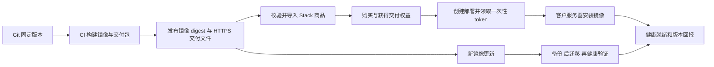

# Retail OMS → Stack 接入与交付验收

日期：2026-10-03。样本仓库：`Industry-solutions/Retail-system-solution/lingcoo-retail-oms`。

本文记录已经实现的自部署流程；正式上线所需事项集中在 [统一待办](retail-stack-user-tasks.md)。[责任契约](app-platform-responsibility-contract.md) 与 [多云规划](app-lifecycle-and-managed-hosting-plan.md) 中的托管、独立 Release 服务和开发者 SDK 等内容仍按规划状态理解。

## 1. 当前标准和职责

应用仓库提供运行镜像、版本化 Manifest、Release 元数据、Compose 配置和安装/升级/备份/恢复能力。业务源码保留在应用仓库，客户安装时不克隆源码。Retail 当前同一个镜像按不同命令运行 Web SSR、API 和 Worker，PostgreSQL 17 与附件卷独立持久化。

Stack 提供商品、价格、购买/支付、交付权益、实例数量和域名约束、一次性部署 token、加密交付配置和版本/健康状态回报。部署后的应用账号及业务使用与 Stack 无关。

严格发布契约位于 `packages/contracts/src/delivery.ts`，版本为 `1`；运行时仍兼容已有 Manifest 归一化逻辑。商品文件同时检查功能/套餐/报价引用、字段和凭据引用、必需镜像 digest、发布入口及正式售价。商品、套餐、报价、交付配置在同一事务导入，避免失败后留下半个可售商品。



## 2. 发布与上架步骤

以下命令用于复现，实际发布操作由工程侧在取得统一待办中的输入后执行。

1. 在 Retail 构建并发布正式镜像，取得目标仓库的 `@sha256:...`。镜像源码版本使用完整 Git SHA，不使用浮动 `latest` 作为交付标识。
2. 设置 `STACK_RUNTIME_IMAGE`、`STACK_SOURCE_REVISION`、`STACK_DELIVERY_BASE_URL`，在 Retail 执行 `pnpm delivery:build`。下载地址必须为该版本的 HTTPS 目录。
3. 发布 `dist/stack-delivery/` 下五个文件：`retail-delivery.tar.gz`、`remote-install.sh`、`fd-delivery.manifest.json`、`release.json`、`SHA256SUMS`。目录不可覆盖成另一版本。压缩包为显式文件白名单，包含配置与脚本，不含业务源码、依赖目录和 `.env`。
4. 在 Stack 使用对应 Release 生成正式商品文件：

   ```bash
   node --import tsx scripts/prepare-retail-product.mjs /path/to/release /path/to/product.json <价格_分> <只读镜像用户名>
   npm run app:validate -- /path/to/product.json --ready
   ```

5. 实际验证下载、校验和与受限凭据拉取镜像。`--ready` 是离线配置检查，不能替代该步骤。跨仓库镜像复制后应分别取得 digest；ACR 与 GHCR 的 manifest digest 可能不同。
6. 通过安全配置注入 `RETAIL_OMS_ACR_PASSWORD`，使用实际平台管理用户 ID 导入：

   ```bash
   npm run app:import -- /path/to/product.json --ready-for-sale --actor-user-id <平台管理用户UUID>
   ```

   此模式强制检查正式配置和所需密钥，不允许跳过交付设置。仓库中的 `app-products/lingcoo_retail_oms/product.json` 保持 inactive，1 分钱仅用于隔离模拟验收。

现有 Retail Deploy 工作流已增加独立发布开关 `PUBLISH_ENABLED`，并兼容既有 `DEPLOY_ENABLED`。设置 `STACK_DELIVERY_BASE_URL` 后，会按构建 digest 和源码 SHA 生成交付包并保存 GitHub artifact；上传公开下载入口仍是单独发布步骤。验收分支不会部署到现有生产服务器。

## 3. 购买、安装与更新

客户在 Stack 应用列表进入商品，完成购买后获得交付权益。当前 Retail 草稿策略为一个有效购买对应一个活动部署，首次成功兑换 token 时绑定完整域名；安装完成另以健康回报确认；策略由正式商品条款确定。

客户创建部署，填写域名与安装必需输入，领取 Stack 生成的安装命令。安装器兑换一次性 token，获得固定镜像和本次配置；第二次兑换同一 token 被拒绝。真实自部署环境需要 Linux、Docker Compose、Python 3、域名解析及 HTTPS 所需端口。

安装器自动生成实例独立的数据库密码和加密密钥。镜像拉取密码不写入应用 `.env`，并使用临时 Docker 登录配置；初始化密码仅用于一次性初始化容器，不进入持续运行的 API/Web/Worker 配置。报告凭据独立保存，用于该部署的状态上报。

仅兑换 token 不视为安装完成。API、Web、Worker 和外部访问检查通过后，才提交 `runtimeHealth=ready` 和实际镜像版本，Stack 记录完成时间。这是自部署安装器提供的观测结果，不是云平台主动监控证明。旧安装器的状态回报仍可接收，但未提供健康就绪信号时，不自动认定安装已经完成。

更新时领取新 token，在安装命令前指定 `DELIVERY_ACTION=update` 与原安装目录。安装器校验实例和域名，先拉取新镜像，保留原数据库凭据和加密密钥，再执行协调备份、迁移、启动和健康检查。失败保留配置与数据；涉及数据库迁移的恢复采用已验证的备份和隔离恢复流程，不自动回滚到可能不兼容的旧镜像。

首次安装中断后，检查失败原因，领取新 token，以 `DELIVERY_ACTION=resume` 在原目录继续。只允许阶段为 `installing` 的原实例，保持首次镜像和原数据凭据；不通过删除卷“重试”。仅状态回报失败时，可在原目录执行 `python3 /path/to/stack-delivery.py report --directory /path/to/installation`。

退款/权益撤销会阻止继续从 Stack 获取部署和更新凭据，不会远程删除客户应用或数据。已经交付的镜像，以及此前获取的长期仓库凭据，不会因为 Stack 权益撤销而自动失效。如果要强制限制后续版本的直接拉取，需要客户级可撤销或短期仓库授权。当前未实现这一机制，也未拆分软件永久使用与单独付费更新服务，不应销售尚未实现的更新期限。

## 4. 实际验收与边界

机器可读结果：[retail-stack-acceptance-result.json](retail-stack-acceptance-result.json)。使用真实 Stack HTTP、隔离 PostgreSQL、源代码无关交付包及实际 Retail Docker 容器；支付适配器仅在测试进程模拟。

| 检查                                            | 结果 |
| ----------------------------------------------- | ---- |
| 重复商品导入、应用目录与密钥隐藏                | 通过 |
| 下单、模拟支付、重复通知只授予一次权益          | 通过 |
| 部署数量限制、跨用户访问阻止、一次性 token      | 通过 |
| 实际 Web/API/Worker 安装、健康和版本回报        | 通过 |
| 两个客户实例的数据库、数据与密码隔离            | 通过 |
| 独立新镜像重新部署、升级前备份、原数据/凭据保留 | 通过 |
| 升级前数据库及附件备份恢复到另一隔离项目        | 通过 |
| 退款后禁止新 token，原客户应用继续存在          | 通过 |

新镜像验收通过改变镜像版本和 image ID 验证替换链路，未把它描述为新的业务功能版本。断点续装有故障模拟测试；数据库迁移失败、备份失败和健康检查失败另有部署脚本门禁测试。尚未完成真实目标上的断电/网络中断演练。

工程回归证据：Stack 47 项单元测试、59 项独立 PostgreSQL 集成测试、6 项后台组件测试及 4 项浏览器回归通过；Retail 5 项 Python 交付测试、5 项部署故障门禁与 1 项源代码无关打包测试通过。新校验同时验证了已有 Edu 商品的兼容性。交付验收与密钥轮换测试使用不同数据库，避免各自测试密钥混用。

本次未正式上架或生产发布，未实际收费、未创建付费云资源。国内真实网络上的下载/拉取/HTTPS、真实支付、腾讯云/阿里云托管，以及国际 Web/API 分开托管需各自验收。Retail 是 SSR + 常驻 Worker + 本地附件卷，不能直接当静态站部署或承诺整实例按请求归零。

## 5. 复现本地验收

先构建本地测试镜像 `lingcoo-retail-oms:smoke-stack-onboarding`，生成 Retail 交付包，再为 Stack 提供专用 PostgreSQL `_test` 数据库和独立 Redis。禁止使用生产数据库。

```bash
DATABASE_TEST_URL=postgres://.../stack_retail_test npm run smoke:retail-delivery
```

测试镜像标签只在显式 loopback `--test-local` 下允许；正式交付必须 digest。验收脚本只清理自己创建的 Retail 项目和恢复项目，运行报告明确 `productionPublished=false`、`managedHostingCertified=false`。
