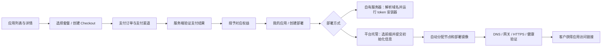

# Stack 应用接入、售卖授权与托管交付全流程

更新：2026-10-08。本文以 Lingcoo Retail OMS 为实际样本。实施证据分别记录在 `retail-stack-acceptance-result.json`、`retail-managed-hosting-acceptance-result.json` 和 `retail-production-hosting-acceptance-result.json` 中；模拟支付不等同于真实收款，试点授权不等同于正式定价上架。

## 1. 产品边界

Stack 是应用展示、商品售卖、权益发放、交付和托管管理平台。当前只支持两种部署服务：

| 方式       | 客户提供                                                                        | Stack 提供                                                                   |
| ---------- | ------------------------------------------------------------------------------- | ---------------------------------------------------------------------------- |
| 自有服务器 | 服务器 IP、已解析域名、应用初始化必填项；在自己的服务器执行安装命令             | 校验购买权益、发放一次性 deploy token、交付镜像配置与安装器、展示部署状态    |
| 平台托管   | 子域名前缀或自动生成、应用初始化必填项；如需自定义域名，配置平台给出的 DNS 记录 | 检查节点健康及容量、分配实例、部署镜像、默认域名 DNS、网关、证书和可访问链接 |

应用的业务账号和部署后的具体使用不属于 Stack。应用来源可以是自研或依法封装的软件，不影响统一交付标准。本期不引入开发者入驻、佣金分账、CloudBase 或 SAE。

## 2. 应用接入标准

一个可交付应用须提供以下资产。Retail 的平台配置模板在 `app-products/lingcoo_retail_oms/product.json`，应用侧入口在 Retail 仓库 `delivery/stack-delivery.py`。

| 资产          | 内容及校验                                                                         |
| ------------- | ---------------------------------------------------------------------------------- |
| 应用标识      | 稳定且唯一的 app code、名称、分类、介绍、状态                                      |
| 商品配置      | plans、offers、价格、币种、支付渠道、权益 feature 与部署数量限制                   |
| 交付 Manifest | 安装器 HTTPS 地址、部署目录、域名槽、普通变量、敏感变量、镜像资产声明              |
| 运行镜像      | 可追溯版本，正式交付锁定 `repository@sha256:...`，不采用漂移的 latest 作为交付依据 |
| 配置分层      | 平台预设值、平台敏感值、客户必填值分别声明；敏感值加密保存，不进入公开商品接口     |
| 执行适配器    | 安装、迁移、初始化、运行健康、版本回报，以及已有自部署更新/恢复动作                |
| 资源声明      | CPU、内存、磁盘预算；托管模板必须明确数据库和附件的持久化方式                      |
| 交付文件      | 版本化部署包、manifest、release.json、安装脚本及 SHA256；只包含必要部署文件        |
| 运维约定      | 备份内容、恢复方法、升级前备份、失败保留数据、日志与故障处理                       |

托管执行器当前安装的是 Retail 适配器，不代表任意镜像只上传就能自动托管。新应用需要声明相同契约，并安装经过验证的应用适配器；不执行客户上传的任意宿主机命令。

## 3. Retail 如何对接

Retail 保持自己的 Git 仓库和镜像发布过程。业务代码编译进镜像，由 Stack 管理交付信息。

- 一个应用镜像分别启动 API、Worker 和 SSR Web 进程，外加 PostgreSQL 和实例入口 Caddy。
- 每客户每应用使用独立 Compose 项目、数据库卷、附件卷、数据库密码和应用密钥。
- 实例网关只接入专用入口网络；数据库不因域名管理而暴露给公共网关。
- 平台管理的总预算为 1 CPU、1024 MiB 内存、10 GiB 磁盘预留。CPU/内存通过容器限制执行；磁盘目前是准入预算和空闲监测，不是文件系统硬配额。
- 当前资源配置经过空载运行验证，不等同于业务峰值容量认证。
- 环境初始化通过一次性容器完成，初始化密码不写入长期运行环境；应用运行参数及数据库凭据按实例隔离。

版本化下载目录：

`https://downloads.lingcoo.com/apps/lingcoo_retail_oms/603fa5fd9988c90ea37b8845acce62e15f0c7d36/`

该目录包含 `remote-install.sh`、`retail-delivery.tar.gz`、`fd-delivery.manifest.json`、`release.json`。实际镜像 digest 和源码/交付版本以 release 文件为准。包校验摘要记录于验收证据。

## 4. 导入与上架

1. 应用发布者构建和推送镜像，生成版本化交付包。
2. 填写 product.json，先保持 app/plan/offer 的 inactive 草稿状态。
3. 平台运维填写镜像 digest、镜像拉取账号、敏感凭据和实际下载地址。
4. 使用 `app:validate` 校验配置；通过 `app:import --dry-run` 预检，再导入商品。正式可售校验使用 `--ready-for-sale`，拒绝占位镜像、占位下载地址和缺失敏感值。
5. 校验应用列表、商品详情、套餐、权益、部署输入和公开响应的敏感信息隐藏。
6. 确认正式售价、权益条款、托管计费方式后启用可售 offer。

仓库内 Retail 的 1 分钱配置是验收模板，不能直接当作正式售价。生产试点可启用应用并由管理员事务发放测试权益，同时保持 plan 和 offer 不可售。本轮不自行确定商业价格，也不执行真实付款。

## 5. 购买和权益发放

平台依据服务端支付通知或主动支付状态核对来更新订单，不信任浏览器的“支付成功”提示。重复回调和重复核对不得重复发放权益。权益记录关联客户、应用、套餐及数量/域名绑定规则；创建部署时检查所有权、有效期和可用部署数。

退款或权益撤销会阻止继续获取交付/更新资格，不远程删除客户已有应用数据。托管终止、迁移和数据导出必须走明确运维流程，不能把退款等同于删除数据卷。

模拟支付只用于隔离测试控制端。生产环境没有开启 mock-pay；验收授权通过管理员权益服务在事务中发放并保留审计，事务提交前恢复套餐不可售状态。

## 6. 客户自有服务器部署

客户输入 IP、域名及初始化信息，先在自己的 DNS 服务商完成解析。Stack 创建部署记录，签发一次性、有时效且绑定部署的 token，并生成安装命令。

客户执行安装命令后，安装器通过 HTTPS 兑换配置，验证应用与镜像，拉取镜像，创建独立数据卷，执行迁移和初始化，再启动服务。安装器只在运行健康检查通过后回报就绪。

客户自行承担该服务器的 DNS 与基础运维。Stack 不自动操作客户 DNS 账号，也不要求客户交出域名管理权限。

## 7. 平台托管自动部署

客户填写或自动生成一个 `xxx.app.lingcoo.com` 前缀，并提交应用要求的初始化信息。

1. **受理**：校验权益、部署限额、前缀唯一性和必填字段，加密保存敏感输入。
2. **排队和分配**：检查启用节点的 Docker 状态、最近资源报告和预算预留。没有容量时保持 `waiting_capacity`，不返回假链接。
3. **领取任务**：节点定时服务凭自己的 report token 领取本节点任务。任务按部署冻结镜像和配置；重复领取可恢复原任务。
4. **真实部署**：拉取应用 digest 镜像，生成独立数据库和加密密钥，执行迁移、初始化、启动和内部健康检查。
5. **运行就绪**：节点回报后进入 `runtime_ready`。这一步还不表示公网已通。
6. **自动 DNS**：Stack 调用 DNSPod 创建 `xxx.app` 记录，保存记录 ID。已有不属于该部署的冲突记录不会被覆盖。
7. **网关和证书**：节点同步入口，校验 Caddy 配置后平滑重载，由 ACME 自动签发证书。
8. **公网确认**：控制端检查真实解析、证书、部署标识和 Web/Admin/API/Worker 入口，全部通过才进入 `ready`。
9. **交付链接**：客户在部署列表看到可访问的 HTTPS 地址。

节点 systemd timer 每次任务结束后约一分钟再次执行，自动上报、领取任务和同步域名。DNS 密钥只保存在 Stack 控制端，不传给客户或 Retail 容器。

失败状态保留配置、数据和资源预留。重试复用原任务和镜像，避免删库重装。托管原地升级、节点迁移与终止回收需独立的受控运维流程；本期主要认证首次部署与失败重试。

## 8. 客户自定义域名

客户在已就绪实例的域名管理中填写 `retail.customer.com`。Stack 返回：

| 类型  | 完整记录名                    | 值                               |
| ----- | ----------------------------- | -------------------------------- |
| CNAME | retail.customer.com           | 客户已分配的 xxx.app.lingcoo.com |
| TXT   | \_lingcoo.retail.customer.com | 当前绑定的随机归属验证值         |

如果绑定根域名且 DNS 服务商不支持根域名 CNAME，改用 A 记录指向平台显示的节点 IPv4，仍需 TXT。迁移节点时，使用 CNAME 的客户可随平台目标更新；使用 A 的客户需要按新入口调整记录。

客户只操作自己的 DNS 服务商一次，无需 DNS 委托或云密钥授权。平台定时检查或客户点击“检查解析”后，验证 TXT 和解析目标；随后自动配置别名路由、应用允许的来源和 HTTPS 证书。验证完成才显示别名访问链接。默认域名继续有效，应用的规范公共 URL 仍为默认域名。

每实例最多五个自定义域名。不支持泛域名输入。跨客户域名占用会被拒绝。解绑进入 `removing`，节点先清理路由与允许来源，再回报完成，之后平台才释放唯一占用。删除前发出的旧健康回报不能冒充解绑完成。

## 9. 备份、恢复和后续运营

节点可安装每日服务器本地时间 04:00 备份 timer（本轮节点为 Asia/Shanghai），备份与部署使用同一个排他锁。备份包含 PostgreSQL、附件、实例配置、密钥、镜像信息和托管资源覆盖配置。现有备份方式短暂停止 API/Worker 写入保证一致性，完成后恢复服务；此窗口需要纳入托管说明。

备份目录权限受限，成功标识及 SHA256 用于检查完整性。恢复先到隔离项目验证，再决定切换，禁止未经验证覆盖客户在线数据库。

同机备份不能应对宿主机丢失。正式托管仍需独立的异机/对象存储加密备份、保留周期、恢复目标和告警策略；本期部署成功不等同于这些运营承诺全部已完成。

## 10. 验收边界

以下事项必须在验收记录中分别列出：商品导入、真实/模拟支付、权益来源、实际镜像拉取、运行健康、默认域名、自定义域名、解绑、备份恢复、生产版本和当前访问链接。

软件售价和托管价格未确认时保持验收/试点状态，不把测试价格公开售卖。真实收款与退款、业务负载测试、整机故障恢复、多节点迁移，以及新版本托管升级不因一次健康检查成功而自动获得认证。

## 11. 2026-10-08 生产试点实测

- 独立部署 ID：`c000d1a7-f0ab-4350-9d89-cad20831651f`，托管节点 `118.25.36.15`。
- 默认入口：<https://retail-demo-20261008.app.lingcoo.com>；管理端在 `/admin/`。
- 自定义入口：<https://retail-demo.lingcoo.com>；这次用平台自有域名模拟客户配置 CNAME/TXT，平台随后自动验证和签发证书。
- 默认与自定义入口的 Web、Admin、API 就绪、Worker 健康均返回 200，部署标识一致，真实管理员登录和对应 CORS 来源通过。
- 额外测试域名完成 ready → removing → 删除；节点清理路由后才释放平台占用，测试 DNS 记录已按记录 ID 和归属标记清理，保留域名继续正常访问。
- 最终代码 CI 通过 55 项单元测试、67 项集成测试和前端/浏览器检查；生产及全依赖审计均为 0 漏洞。
- 节点实际执行仓库登录和应用镜像拉取，没有启用仅缓存镜像模式；交付镜像按 digest 固定。
- 总容器预算 1 CPU / 1024 MiB，本轮空载采样约 315 MiB；这不是压力测试结果，也不是可容纳客户数量的承诺。
- 备份包含数据库、附件、配置和密钥，校验清单通过；隔离恢复得到 79 张 public 表、管理员及密码凭据记录，附件探针内容一致。恢复项目没有启动 API/Worker，不是整机切换演练。
- 原有业务实例保留；旧独立试点停止但保留数据卷，新验收实例持续运行。

真实商业支付尚未执行。生产试点权益来自管理员审计授权，套餐和交付 Offer 未开放售卖。当前镜像凭据仅用于受控运营试点，公开自部署交付前需换成专用只读拉取凭据。

详见 [生产验收数据](retail-production-hosting-acceptance-result.json)、[模拟交易验收数据](retail-commerce-acceptance-result.json)、[节点运维](managed-hosting-operations.md) 与 [商用待办](retail-stack-user-tasks.md)。

生产 Stack 运行代码：`4d10d8a428126d9d61f36875672f7409f7683ca3`；[CI](https://github.com/LingcooTech/lingcoo-core-stack/actions/runs/37656651412) 与 [生产发布](https://github.com/LingcooTech/lingcoo-core-stack/actions/runs/37657444112) 均成功，线上 `/ready` 版本匹配。随后仅补充本文及验收记录，不再重复发布相同运行代码。
